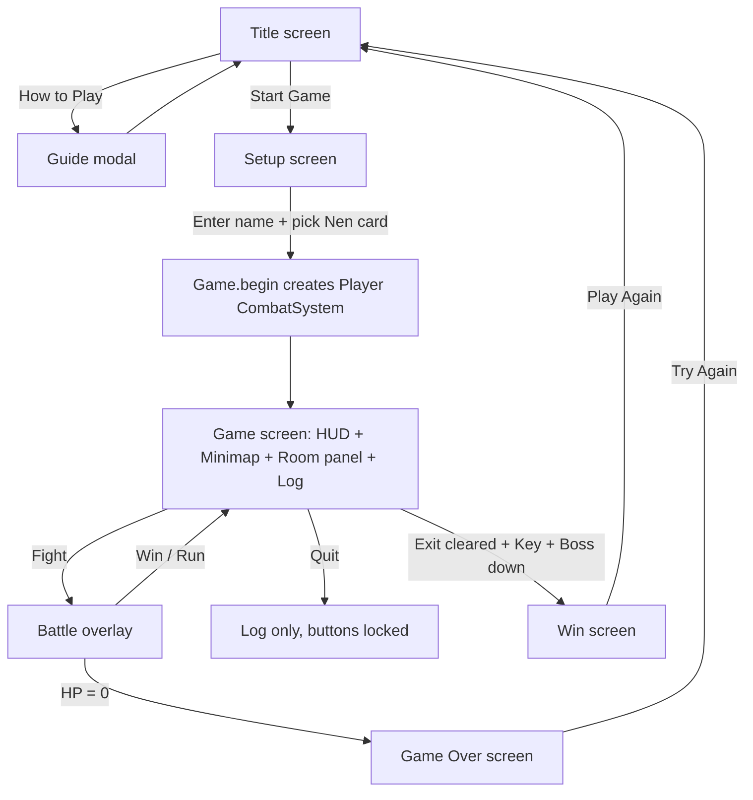
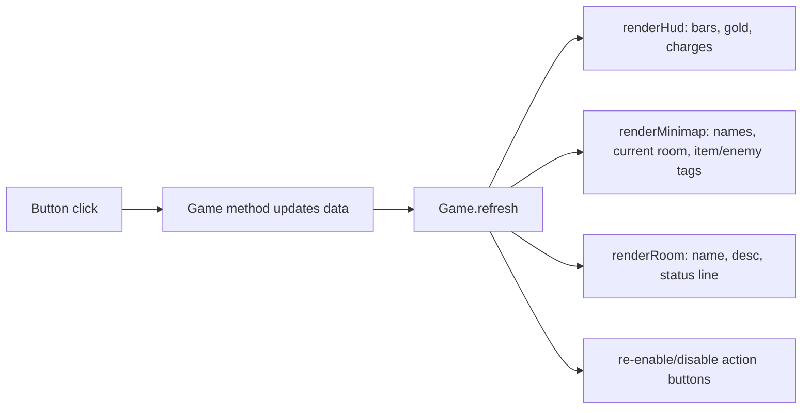
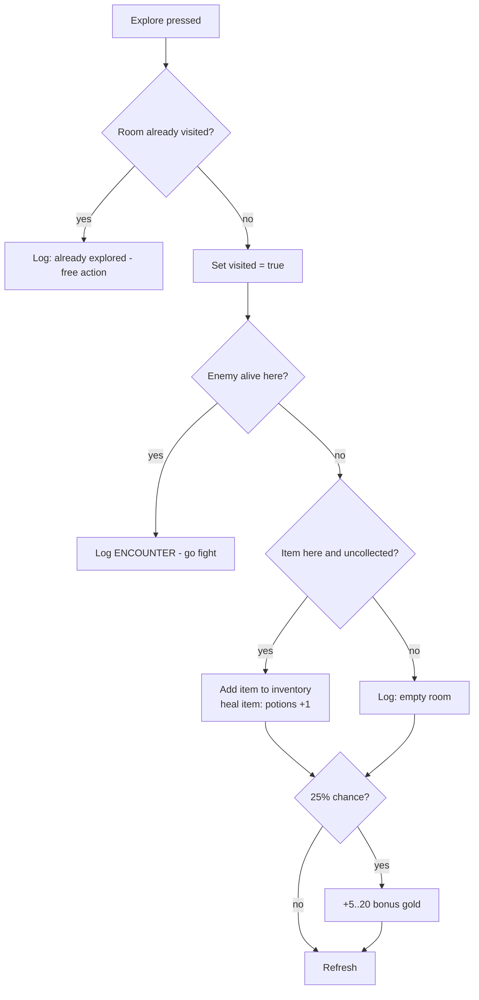
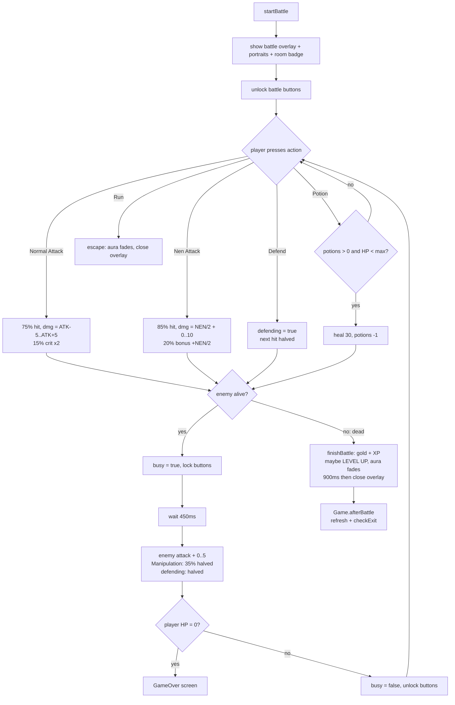
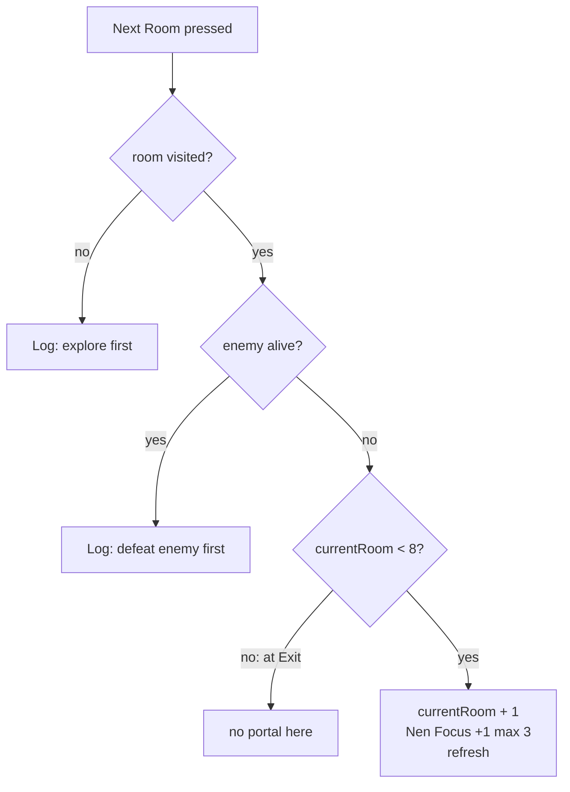
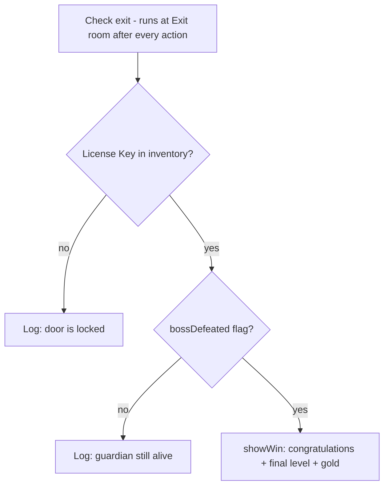

# Flowcharts — Web Version

(GitHub and VS Code render the `mermaid` blocks; the ASCII version stays in `02_Game_Flowchart.md`.)

## 1. Screen flow

## 2. Refresh cycle — what happens after ANY action

## 3. Explore logic (Game.explore)

## 4. Battle turn sequence (CombatSystem)

## 5. Portal / room progression rules (Dungeon.portalAvailable)

## 6. Win / lose condition (Game.checkExit)

